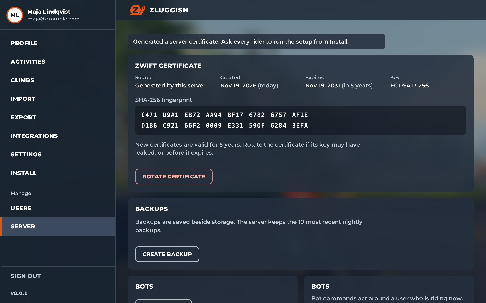
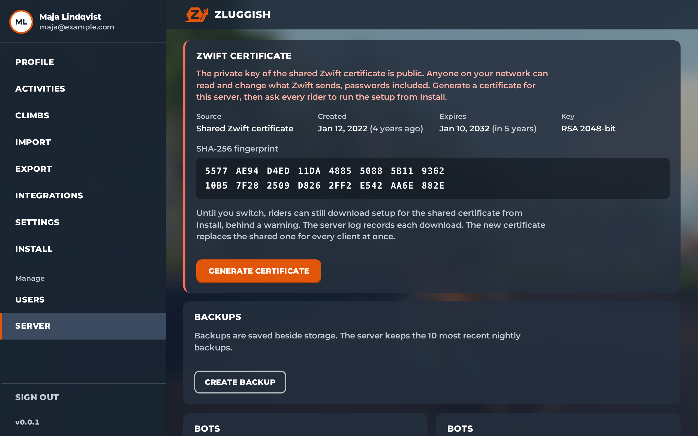
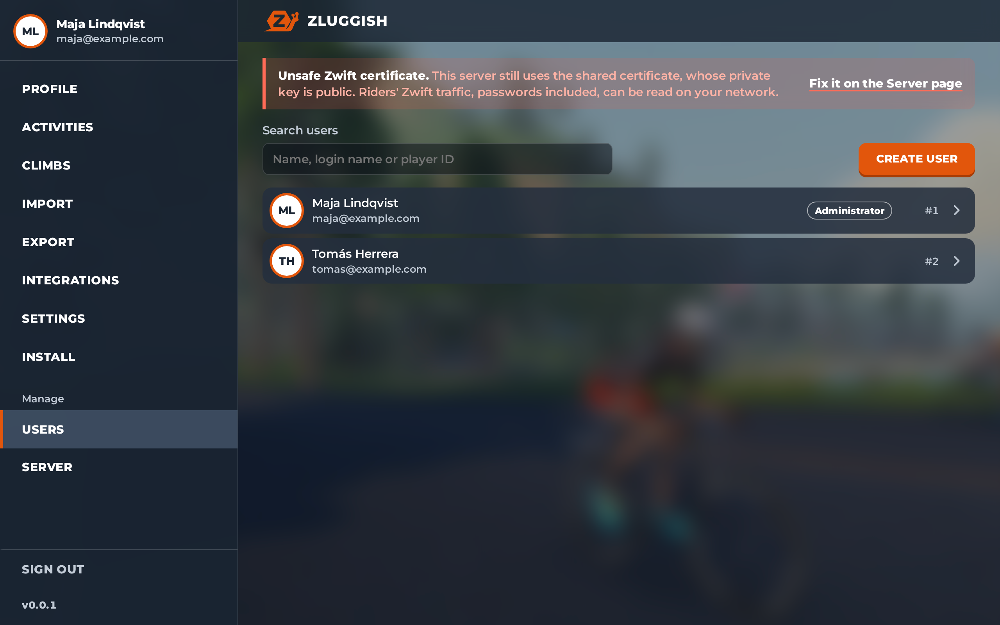
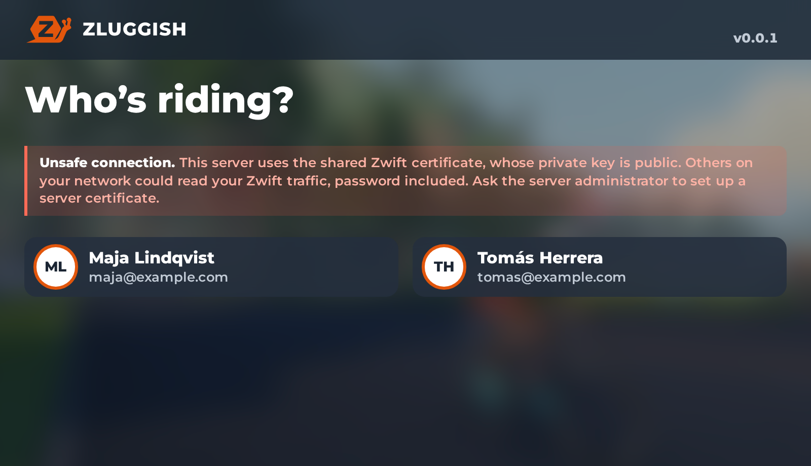

# Server certificate

Zwift talks to Zluggish over HTTPS, as if Zluggish were `secure.zwift.com`. Each Zwift computer must trust the certificate that the server shows.



## Where the certificate comes from

The web app shows the certificate under **Manage → Server**, in **Zwift certificate**: where it comes from, its SHA-256 fingerprint, when it was created and when it expires.

| Source                   | When                                                                                                        |
| ------------------------ | ----------------------------------------------------------------------------------------------------------- |
| Generated by this server | A new server makes its own key and certificate on the first start.                                          |
| Shared Zwift certificate | A server that had riders before this version keeps the old shared certificate.                              |
| Configuration files      | `tls.certFile` and `tls.keyFile` name your own certificate and key. See [below](#use-your-own-certificate). |

The generated certificate has an ECDSA P-256 key. It is valid for 5 years, or for `tls.lifetimeYears`. It is only for the Zwift host names (`*.zwift.com`) and only for TLS servers: a computer that trusts it trusts nothing else. The server keeps the key and the certificate in `storage/tls/zwift-server.pem`. Backups include it.

## Move away from the shared certificate

:::danger

The private key of the shared certificate is public. Anyone on your network can read and change what Zwift sends to the server, passwords included. While the server uses it, the server log has a `tls.legacy_certificate` warning at each start, and the launcher shows a warning to every rider.

:::

1. In the web app, open **Manage → Server**.

   

2. Under **Zwift certificate**, select **Generate certificate**.
3. Ask every rider to set up each computer again from **Apps** in the web app. See [Windows](clients/windows.md), [macOS](clients/macos.md) and [Linux](clients/linux.md).

The new certificate takes effect at once. Until a computer is set up again, Zwift on it cannot connect.

Android devices patched with ZofflineObb accept only the shared certificate. They cannot connect after the change.

### Until you switch

The server keeps working with the shared certificate, so that you can switch when it suits you. Until then:

- The server log has a `tls.legacy_certificate` warning at each start.
- Administrators see a warning at the top of every web app page, with a link to **Manage → Server**.

  

- The launcher shows a warning to every rider.

  

- **Install** still offers setup for the shared certificate, behind a warning that the rider must accept. The script installs the certificate without its private key, prints the warning when it runs, and the server log has a `tls.legacy_setup_download` warning for each download.

## Rotate the certificate

Rotate the certificate if its key may have leaked, or before it expires. The server warns in the log 90 days before the certificate expires.

1. In the web app, open **Manage → Server**.
2. Under **Zwift certificate**, select **Rotate certificate**.
3. Ask every rider to run the setup from **Apps** again. The setup removes the old certificate of this server.

## Use your own certificate

To use your own certificate and key, set both files in `zluggish.config.ts`, in PEM format:

```ts
tls: {
  certFile: './certs/zwift.crt',
  keyFile: './certs/zwift.key',
},
```

The certificate must be valid for the Zwift host names. The web app shows it and offers it on **Install**, but cannot rotate it. To change it, replace the files and start the server again.
