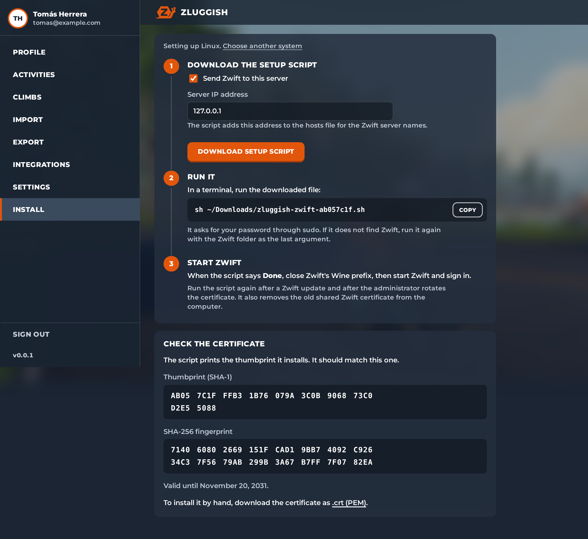

# Linux

This procedure is for Zwift for Windows in Wine, Lutris, Bottles or Steam (Proton). It makes Linux and Zwift trust the [server certificate](../certificate.md) and redirects Zwift to Zluggish.

## Set up the client

1. Install Zwift, if it is not installed.
2. Sign in to the Zluggish web app and select **Install** in the menu.
3. On a Linux computer, **Install** opens the Linux setup. On another device, select **Choose another system**, then **Linux**. Check the IP address of the server, then select **Download setup script**. The address is `server.advertisedIp` from the server configuration.

   

4. Close Zwift. In a terminal, run the script:

   ```sh
   sh ~/Downloads/zluggish-zwift-*.sh
   ```

   The script asks for your password through `sudo`. It:
   - adds the certificate to the system trust store,
   - adds the certificate to `data/cacert.pem` of each Zwift that it finds in a Wine, Lutris, Bottles or Steam prefix, and removes the old shared certificate there,
   - points the Zwift host names at the server in `/etc/hosts`.

5. If the script does not find Zwift, run it again with the Zwift folder:

   ```sh
   sh ~/Downloads/zluggish-zwift-*.sh "$HOME/.wine/drive_c/Program Files (x86)/Zwift"
   ```

6. If the Wine prefix is still running, stop it with `wineserver -k`.

Run the script again after a Zwift update, and after the administrator rotates the certificate.

The script saves the original files as `cacert.pem.zluggish-backup` and `/etc/hosts.zluggish-backup`.

## Check the certificate

The **Install** page shows the thumbprint and the SHA-256 fingerprint of the certificate. The script stops if its certificate does not match its thumbprint.

## Next step

Start Zwift, select your user and sign in. To stop using Zluggish, see [Uninstall](../../maintenance/uninstall.md).
