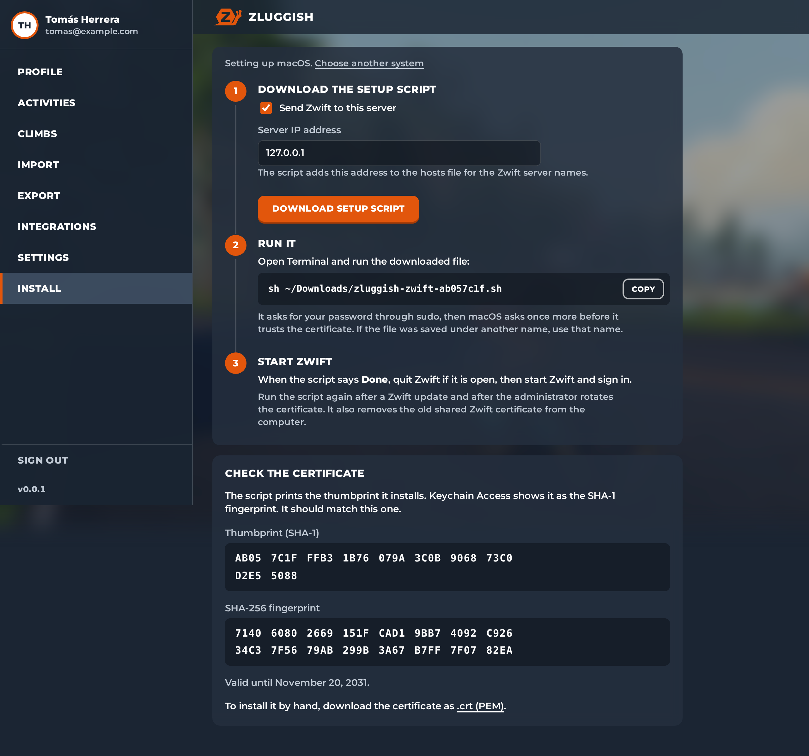

# macOS

This procedure makes macOS and Zwift trust the [server certificate](../certificate.md) and redirects Zwift to Zluggish.

## Set up the client

1. Install Zwift, if it is not installed. Start it once and quit it, so that it creates its data folder.
2. Sign in to the Zluggish web app and select **Apps** in the menu.
3. On a Mac, select **Set up macOS**. On another device, select **Other systems** under **Zwift**, then **macOS**. Check the IP address of the server, then select **Download setup script**. The address is `server.advertisedIp` from the server configuration.

   

4. Quit Zwift. Open Terminal and run the command that the **Install** page shows, for example:

   ```sh
   sh ~/Downloads/zluggish-zwift-*.sh
   ```

   The script asks for your password through `sudo`, and macOS asks again before it changes certificate trust. It:
   - adds the certificate to the System keychain and trusts it for TLS, and removes the certificates that earlier setups of this server added, and the old shared certificate,
   - adds the certificate to `~/Library/Application Support/Zwift/data/cacert.pem`, and removes the old shared certificate there,
   - points the Zwift host names at the server in `/etc/hosts`.

5. If the script does not find Zwift, run it again with the Zwift folder:

   ```sh
   sh ~/Downloads/zluggish-zwift-*.sh "$HOME/Library/Application Support/Zwift"
   ```

Run the script again after a Zwift update, and after the administrator rotates the certificate.

The script saves the original files as `cacert.pem.zluggish-backup` and `/etc/hosts.zluggish-backup`.

Do not import the certificate with Keychain Access instead. Double-clicking the file, or **File → Import Items…**, can add it without any message and without trusting it.

## Check the certificate

The **Install** page shows the thumbprint and the SHA-256 fingerprint of the certificate. The script stops if its certificate does not match its thumbprint. In Keychain Access, the certificate is **\*.zwift.com** in the **System** keychain, and its SHA-1 fingerprint is the thumbprint.

## Next step

Start Zwift, select your user and sign in. To stop using Zluggish, see [Uninstall](../../maintenance/uninstall.md).
