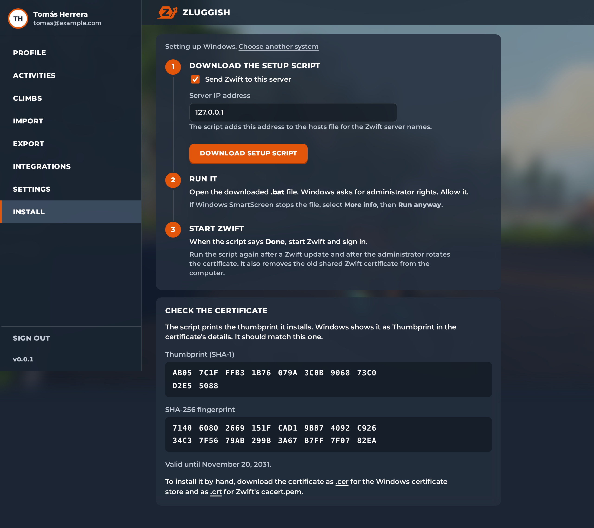

# Windows

How to setup a Windows Zwift client to talk to Zluggish.

## Automatic install (recommended)

1. Install the official Zwift app
2. Star the Zwift app and check if there are any updates, don't login
3. Close the Zwift app
4. Sign in to the Zluggish web app and select **Apps** in the menu.
5. Download the setup batch script

   

6. Open the downloaded `.bat` file and let it run. Allow it to make changes when Windows asks. If SmartScreen stops it, select **More info**, then **Run anyway**.
7. Wait until the window says **Done**.

You can now start the Zwift app and it should show the Zluggish launcher. Enjoy!

You might need to re-download the script and run it again if Zwift updates.

Here is what the script does:

- trusts the server certificate in **Local Computer → Trusted Root Certification Authorities**, and removes any old Zluggish and legacy zwift-offline certificates
- adds the certificate to `data\cacert.pem` in the Zwift folder,
- points the Zwift host names at the server in `C:\Windows\System32\drivers\etc\hosts`.

It saves the original files as `cacert.pem.zluggish-backup` and `hosts.zluggish-backup`.

## Manual install

1. On the **Install** page, under **Check the certificate**, download the certificate as `.cer`.
2. Open Command Prompt as an administrator, go to the directory with the file and import it:

   ```bat
   certutil.exe -addstore Root zluggish-zwift-XXXXXXXX.cer
   ```

3. Download the certificate as `.crt` too. Open Notepad as an administrator, open `C:\Program Files (x86)\Zwift\data\cacert.pem` and add the contents of the `.crt` file to the end. Save the file.
4. In Notepad, open `C:\Windows\System32\Drivers\etc\hosts`. Add this line to the end of the file. Replace `<server-ip>` with the IP address of the Zluggish server:

   ```text
   <server-ip> us-or-rly101.zwift.com secure.zwift.com cdn.zwift.com launcher.zwift.com
   ```

5. Save the file.

If Zluggish and Zwift run on the same computer, use `127.0.0.1` as the IP address.
