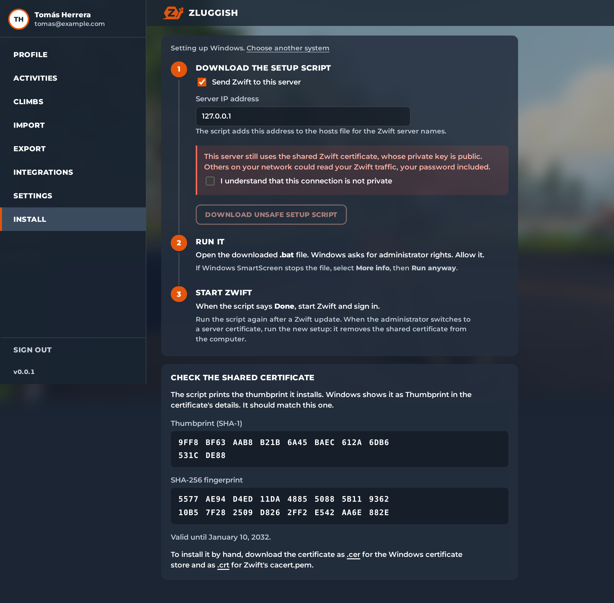

# Windows

This procedure makes Windows and Zwift trust the [server certificate](../certificate.md) and redirects Zwift to Zluggish.

## Set up the client

1. Install Zwift, if it is not installed.
2. Sign in to the Zluggish web app and select **Apps** in the menu, then **Client**.
3. On a Windows computer, **Client** opens the Windows setup. On another device, select **Choose another system**, then **Windows**.
4. Check the IP address of the server, then select **Download setup script**. The address is `server.advertisedIp` from the server configuration.

   

5. Open the downloaded `.bat` file. Allow it to make changes when Windows asks. If SmartScreen stops it, select **More info**, then **Run anyway**.
6. Wait until the window says **Done**.

The script:

- trusts the server certificate in **Local Computer → Trusted Root Certification Authorities**, and removes the certificates that this server installed before and the old shared certificate,
- adds the certificate to `data\cacert.pem` in the Zwift folder, and removes the old shared certificate there,
- points the Zwift host names at the server in `C:\Windows\System32\drivers\etc\hosts`.

It saves the original files as `cacert.pem.zluggish-backup` and `hosts.zluggish-backup`. Run it again after a Zwift update, and after the administrator rotates the certificate.

To check the certificate, compare the thumbprint that the script shows with the thumbprint on the **Install** page.

## Set up the client by hand

1. On the **Install** page, under **Check the certificate**, download the certificate as `.cer`.
2. Open Command Prompt as an administrator, go to the directory with the file and import it:

   ```bat
   certutil.exe -addstore Root zluggish-zwift-XXXXXXXX.cer
   ```

3. Download the certificate as `.crt` too. Open Notepad as an administrator, open `C:\Program Files (x86)\Zwift\data\cacert.pem` and add the contents of the `.crt` file to the end. Save the file.
4. In Notepad, open `C:\Windows\System32\Drivers\etc\hosts`. Add this line to the end of the file. Replace `<server-ip>` with the IP address of the Zluggish server:

   ```text
   <server-ip> us-or-rly101.zwift.com secure.zwift.com cdn.zwift.com launcher.zwift.com
   ```

5. Save the file.

If Zluggish and Zwift run on the same computer, use `127.0.0.1` as the IP address.

## Servers with the shared certificate

Until the administrator [moves away from the shared certificate](../certificate.md#move-away-from-the-shared-certificate), the **Install** page offers setup for the shared certificate, behind a warning.


Select **I understand that this connection is not private** to download it. The script installs the certificate without its private key and prints the warning when it runs.

When the server has its own certificate, run the new setup. It removes the shared certificate from the computer.

## Next step

Start Zwift, select your user and sign in. To stop using Zluggish, see [Uninstall](../../maintenance/uninstall.md).
